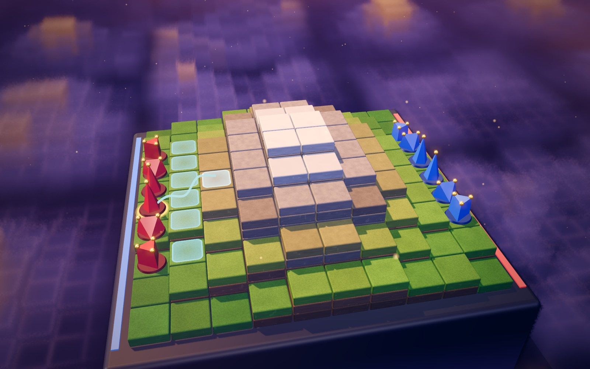
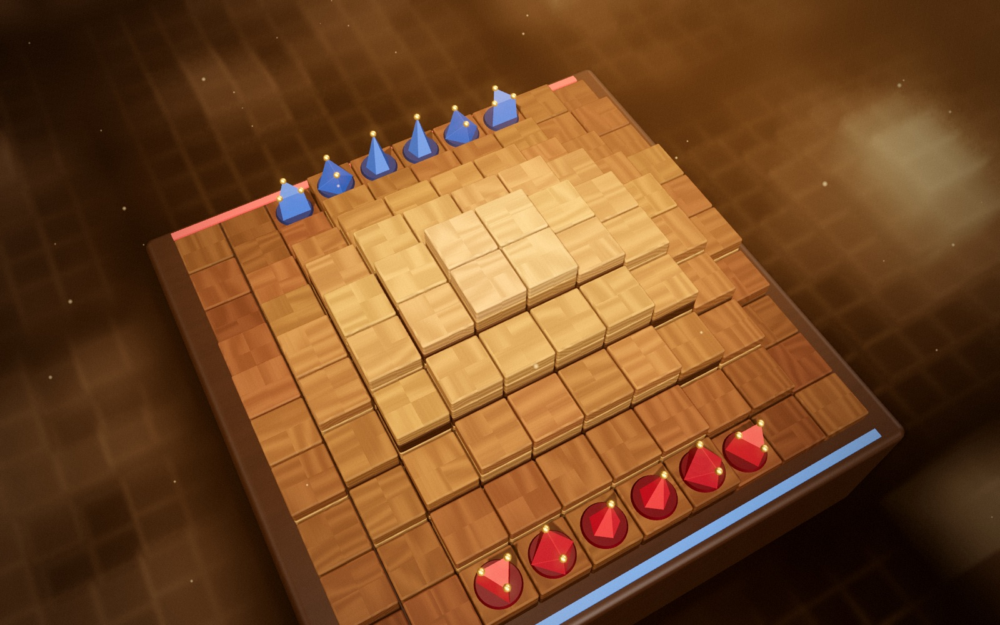

# Traversal 3D

Une adaptation en 3D (Three.js) du jeu de stratégie **Traversal**, jouable dans le navigateur à deux joueurs sur le même écran ou contre un bot.

🎮 **Jouer directement en ligne : [strong-frangipane-d167ff.netlify.app](https://strong-frangipane-d167ff.netlify.app/)**



> ### ⚠️ Les règles ne sont pas de moi
> **Traversal** est un jeu original dont les règles, le concept et le nom appartiennent à leurs créateurs.
> Ce dépôt est un projet de fan, **non officiel et sans lien** avec eux : une simple réimplémentation
> visuelle réalisée par passion, à partir des règles publiées sur leur site.
>
> 👉 **Découvrez, jouez et soutenez le jeu original sur [traversalgame.com](https://www.traversalgame.com/)**
> — règles officielles, tutoriel interactif, parties en ligne et générateur de plateaux pour l'édition physique :
> [www.traversalgame.com/rules](https://www.traversalgame.com/rules)
>
> 🎬 J'ai découvert le jeu grâce à la vidéo d'Ilyas, [« Le jeu qui va écraser les échecs (Traversal) »](https://www.youtube.com/watch?v=QkmivBpoRbw) :
> une excellente présentation pour le découvrir à votre tour.

---

## Le jeu en bref

Traversal se joue sur une grille de 10×10 cases de hauteurs différentes : un paysage de montagnes et de vallées.
Chaque joueur dispose de six pièces et doit leur faire traverser le plateau, puis sortir par le bord opposé.
Chaque pièce arrivée rapporte sa Force. Dès que deux pièces (tous camps confondus) ont franchi l'arrivée, le meilleur score l'emporte.

| Pièce | Mouvement | Force | Particularité |
|---|---|---|---|
| ⬟ Explorateur | 5 | 1 | Pas en diagonale ou bond de 2 cases, sans coût de hauteur |
| ◆ Avant-garde | 4 | 2 | +1 en attaque si le plus court chemin vers la cible coûte exactement 4 |
| ▲ Sentinelle | 3 | 3 | Victoire immédiate si elle est la toute première pièce à arriver |

- Un pas coûte **1 + la différence de hauteur**. On ne traverse aucune pièce.
- Attaquer, c'est entrer sur la case ennemie. L'attaque n'est permise que si **Attaque ≥ Défense** :
  la hauteur (±1), les alliés adjacents et les renforts du défenseur comptent.
- Limite de 200 coups.

Les règles complètes et officielles sont sur [traversalgame.com/rules](https://www.traversalgame.com/rules).

## Ce que propose cette version

- **Trois modes** : 2 joueurs en local, contre un bot (facile, moyen, difficile, expert), ou **bot contre bot**
  pour regarder jouer le bot le plus fort : pause, coup par coup, et navigation dans les coups déjà joués
  (◀ ▶ ou flèches du clavier) avec l'analyse de chacun, pendant ou après la partie.
- **Apprendre du bot** : le panneau *Analyse* explique chaque coup du bot (chances de gain estimées, course des
  Sentinelles, captures, pièces mises à l'abri ou laissées en prise, menaces créées), montre la suite qu'il prévoit
  (traçable sur le plateau), les coups qu'il a écartés et ce qu'ils auraient coûté, et la courbe d'évaluation de la partie.
  Au tour d'un joueur humain, *Conseil* montre le coup que le bot jouerait dans la position, et pourquoi.
- **Analyse de partie** : en fin de partie (contre le bot ou à deux), chaque coup humain est noté
  (meilleur coup, excellent, bon, imprécision, erreur, gaffe) en le comparant au meilleur coup du moteur.
  Le bilan donne une précision par joueur et la courbe des chances. Un clic sur un coup ramène le plateau à
  cette position, trace le coup joué et le meilleur coup, et explique la différence.
- **Un bot rapide** : c'est un moteur écrit en Rust et compilé en WebAssembly (`engine/`), qui tourne dans un Web Worker :
  negamax alpha-bêta avec table de transpositions, ~1 million de positions/s dans le navigateur,
  une dizaine de coups d'avance en niveau difficile.
- **Plateaux générés** avec 6 modes de terrain (aléatoire, montagnes, vallées, hautes terres, bois, désert)
  et 2³² graines, soit plus de 25 milliards de mondes possibles. Chaque partie affiche son numéro de monde.
- **Interface d'aide** : cases accessibles, chemin et coût au survol, détail du combat attaque contre défense,
  fiche de pièce, annulation, affichage des hauteurs, règles intégrées.
- **8 thèmes visuels** : Crépuscule, Atelier (bois), Lagon, Braise, Givre, Ardoise, Marbre & or, Néon.
  Chacun a sa matière de case procédurale, son décor, ses particules et son post-traitement.
- **Décor « espace des possibles »** : le plateau joué se dresse au milieu d'un pavage infini d'autres plateaux,
  rendu en raymarching volumétrique et brumeux, qui se transforme lentement.
- **Pensé pour la fluidité** : vise 120 images/s. Le décor est rendu en demi-résolution, les ombres ne sont
  recalculées que quand quelque chose bouge, et les particules sont animées sur GPU.
- **Qualité graphique adaptée à l'appareil** (menu → Personnaliser) : haute, moyenne, basse ou *auto*.
  En auto, le jeu démarre en qualité moyenne sur mobile et baisse d'un cran s'il tourne sous 45 images/s.
  Le niveau bas rend la scène sans post-traitement, avec un décor allégé et moins de particules.



## Guide de stratégie

Le [guide de stratégie](docs/guide-strategie.md) rassemble les principes que l'on peut tirer de 13 000 parties jouées
par le bot contre lui-même : course des Sentinelles, valeur des pièces, combat, défense, géographie du plateau,
particularités de chaque terrain.

## Lancer le jeu

Le projet n'a aucune étape de build : ce sont des modules ES, avec Three.js chargé depuis un CDN.
Il faut simplement le servir en HTTP (ouvrir `index.html` directement ne fonctionne pas, à cause des modules et du Web Worker) :

```bash
python3 serve.py        # puis ouvrir http://localhost:8765
```

`serve.py` est un petit serveur local qui désactive le cache du navigateur, pratique pendant le développement.
N'importe quel serveur statique convient aussi, par exemple `python3 -m http.server`.

### Recompiler le bot

Le fichier `engine/traversal.wasm` est fourni ; il ne faut le recompiler qu'après avoir modifié le moteur Rust :

```bash
rustup target add wasm32-unknown-unknown   # une seule fois
engine/build.sh
```

Le même crate fournit un banc d'essai natif multi-thread (`engine/src/bin/selfplay.rs`) :

```bash
cd engine && cargo build --release
./target/release/selfplay match games=400 a.nodes=100000 b.nodes=100000 b.legacy=1   # comparer deux réglages
./target/release/selfplay gen games=1000 nodes=100000 out=parties.jsonl            # parties pour les statistiques
python3 analysis/analyze.py parties.jsonl                                          # rapport statistique
```

## Commandes

- **Clic** sur une de vos pièces pour la sélectionner, puis sur une case en surbrillance pour jouer.
- **Glisser** pour tourner la caméra, **molette** pour zoomer.
- **Cmd/Ctrl + Z** pour annuler, **Échap** pour désélectionner.
- En bot contre bot, **← →** pour revoir les coups déjà joués.

## Structure

| Fichier | Rôle |
|---|---|
| `index.html` | Interface (HUD, menus, styles) |
| `main.js` | Rendu Three.js : plateau, pièces, décor, effets, post-traitement, interactions |
| `game.js` | Moteur de règles (pur, sans DOM) et générateur de terrain |
| `ai-worker.js` | Web Worker du bot : charge `engine/traversal.wasm`, renvoie le coup et son analyse |
| `coach.js` | Explication des coups du bot à partir de l'analyse du moteur (panneau *Analyse* et *Conseil*) |
| `review.js` | Analyse de fin de partie : notation des coups humains, bilan, détail des fautes |
| `engine/` | Moteur du bot en Rust (règles, recherche, évaluation), banc d'essai et analyses statistiques |
| `ai.js` | Ancien bot en JavaScript, utilisé en secours si le WebAssembly ne se charge pas |
| `themes.js` | Définition des thèmes (palettes, matières, effets), documentée en tête de fichier |
| `serve.py` | Serveur de développement sans cache |

## Crédits

- **Jeu original, règles et concept** : [Traversal](https://www.traversalgame.com/). Tous droits réservés à leurs auteurs.
- **Découverte du jeu** : la vidéo [« Le jeu qui va écraser les échecs (Traversal) »](https://www.youtube.com/watch?v=QkmivBpoRbw) d'[Ilyas](https://www.youtube.com/@Ilyas-he9di).
- **Moteur 3D** : [Three.js](https://threejs.org/).
- **Polices** : Space Grotesk et Inter (Google Fonts).
- Cette adaptation a été développée avec l'aide de [Claude Code](https://claude.com/claude-code).

## Licence

Le code de ce dépôt est distribué sous [licence MIT](LICENSE).
Elle ne couvre que cette réimplémentation : le nom **Traversal**, les règles et le concept du jeu restent la propriété
de leurs créateurs ([traversalgame.com](https://www.traversalgame.com/)).
