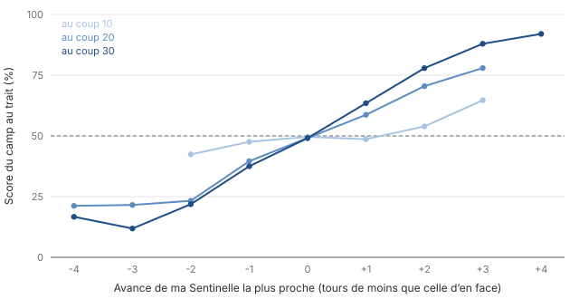
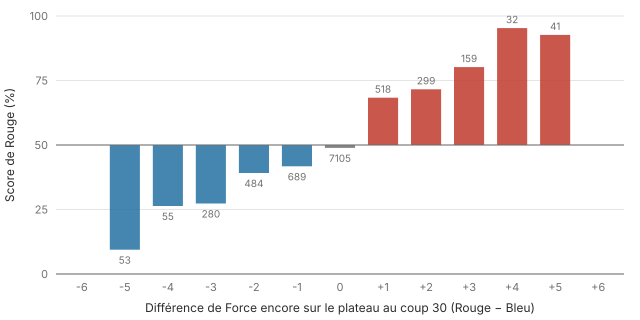
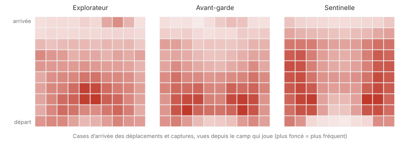

# Guide de stratégie de Traversal

*Ce que disent 13 000 parties jouées par le bot contre lui-même. Première version.*

Ce guide ne remplace pas les [règles officielles](https://www.traversalgame.com/rules). Il cherche à dégager, à partir des
statistiques, des principes généraux : ce qui fait gagner, ce que valent les pièces, où et comment les jouer.

## Méthode, et ses limites

- **Deux corpus** joués par le moteur du jeu (`engine/`) contre lui-même, sur des plateaux tirés au hasard parmi
  les 6 types de terrain :
  - **A** : 12 000 parties à 100 000 positions examinées par coup (≈ 8 à 9 coups d'avance) ;
  - **B** : 1 000 parties à 1 million de positions par coup (≈ 11 à 13 coups d'avance), donc plus fortes.
- Les deux premiers coups de chaque partie sont légèrement bruités pour varier les parties.
- **Ce sont des statistiques sur le jeu d'un bot**, pas une vérité sur le jeu parfait. Une tendance peut refléter
  le style du bot plutôt qu'une loi du jeu. On ne retient donc comme **solides** que les constats identiques
  dans les deux corpus. Quand c'est possible, on les appuie sur des **expériences de style** : deux versions du bot
  qui ne diffèrent que par un principe s'affrontent sur 400 parties, et l'écart Elo dit lequel des deux principes gagne.
- Les pourcentages sont des **scores** (victoire = 1, nul = ½) ; les intervalles sont à 95 %.
- On compte les coups des deux camps (un « coup » = un déplacement d'un joueur).

Pour reproduire ou étendre ces chiffres : voir [`engine/analysis/`](../engine/analysis/) et la section
« Recompiler le bot » du README.

---

## L'essentiel en 10 principes

1. **La course des Sentinelles décide de la moitié des parties.** Avoir sa Sentinelle un tour plus près de la sortie
   que celle d'en face au coup 30, c'est 63 % de score ; deux tours, 78 %.
2. **Un tour d'avance de Sentinelle vaut une pièce entière** (une Avant-garde ou une Sentinelle sur le plateau).
3. **Ne sortez jamais un Explorateur en premier**, sauf si une seconde pièce suit aussitôt : le camp qui le fait
   ne marque que 30 % des points.
4. **Sortir une Avant-garde en premier est un pari à 50 %** : l'adversaire gagne s'il sort une Sentinelle, fait nul
   avec une Avant-garde.
5. **Les Sentinelles passent par les bords.** Plus de la moitié de leurs déplacements se font dans les deux colonnes
   extérieures de chaque côté.
6. **Les captures sont la règle, pas l'exception** : plus de 4 par partie, 96 à 98 % des parties en comptent au moins
   une. Gagner le bilan des captures, c'est 73 à 76 % de score.
7. **La hauteur est la meilleure arme** : la moitié des captures se font depuis une case plus haute, à peine 11 %
   depuis une case plus basse.
8. **Restez groupés** : une pièce collée à deux alliés est capturée trois fois moins souvent qu'une pièce isolée.
9. **L'Explorateur est la pièce la plus exposée et la moins précieuse** : il vaut moins de la moitié d'une
   Avant-garde. Utilisez-le pour gêner, menacer et bloquer.
10. **Jouer en premier n'avantage pas** : Rouge marque 49 à 50 %. En revanche, un nul sur six environ, et de plus
    en plus quand le niveau monte.

---

## 1. Comment une partie se termine

| Fin de partie | Corpus A | Corpus B (plus fort) |
|---|---|---|
| Une Sentinelle sort la première (victoire immédiate) | **53 %** | **49 %** |
| Deux pièces sont sorties, le meilleur score gagne | 45 % | 49 % |
| Limite de 200 coups | 2 % | 2 % |
| Plus aucun coup possible | < 0,1 % | < 0,1 % |

Une partie dure en moyenne 53 coups (A) à 60 coups (B). La moitié se jouent en moins de 46 à 52 coups.

### Qui sort en premier, et ce que ça rapporte

| Première pièce sortie | Fréquence (A) | Score du camp qui sort (A) | (B) |
|---|---|---|---|
| Sentinelle | 54 % | 100 % (règle) | 100 % |
| Avant-garde | 32 % | 43 % | 51 % |
| Explorateur | 14 % | **30 %** | **34 %** |

**Comprendre l'arithmétique de la fin.** Dès qu'une pièce est sortie, la sortie suivante termine la partie. Si
l'adversaire est sorti avec une pièce de Force F :

- sortir une pièce plus forte que F fait gagner ;
- sortir une pièce de même Force fait nul ;
- sortir une seconde pièce **du camp qui a déjà marqué** lui fait gagner, quelle que soit cette pièce.

Les enchaînements les plus fréquents (corpus A) le confirment :

| Première sortie, puis seconde | Parties | Résultat pour le premier sorti |
|---|---|---|
| Avant-garde, puis Avant-garde adverse | 1 418 | nul |
| Avant-garde, puis **Sentinelle adverse** | 1 415 | défaite |
| Explorateur, puis **Sentinelle adverse** | 915 | défaite |
| Avant-garde, puis Explorateur du même camp | 436 | victoire |
| Explorateur, puis Explorateur adverse | 414 | nul |
| Avant-garde, puis Sentinelle du même camp | 274 | victoire |

> **Principe.** Sortir une pièce qui n'est pas une Sentinelle, c'est **ouvrir la fin de partie** à son adversaire. Ne
> le faites que si (a) l'adversaire n'a aucune pièce assez forte capable de sortir rapidement, ou (b) une deuxième
> pièce à vous peut sortir avant toute réponse. Sortir un Explorateur en premier offre la victoire à n'importe quelle
> Avant-garde ou Sentinelle adverse.

Ce principe explique aussi l'essentiel des **nuls** (15 % en A, 20 % en B) : deux Avant-gardes ou deux Explorateurs
qui sortent chacun de leur côté.

---

## 2. La course des Sentinelles

Une Sentinelle qui sort la première gagne immédiatement. Tout le début de partie tourne donc autour d'une
question : **quelle Sentinelle sortira la première ?**

On mesure l'avance d'un camp comme le nombre de tours de moins dont sa Sentinelle la plus proche a besoin pour sortir,
sur le terrain seul, par rapport à celle d'en face.

| Avance au coup 20 | −3 | −2 | −1 | 0 | +1 | +2 | +3 |
|---|---|---|---|---|---|---|---|
| Score (A) | 22 % | 23 % | 40 % | 49 % | 59 % | 71 % | 78 % |

- Au coup 10, les positions sont encore indécises : l'avance n'y pèse presque rien.
- Dès le coup 20, **chaque tour d'avance vaut environ 10 points de score** ; au coup 30, 13 à 15 points.
- La régression sur 140 000 positions (section 3) le confirme : **un tour d'avance de Sentinelle pèse autant qu'une
  Avant-garde de plus sur le plateau**.

**Le bot ouvre presque toujours avec ses Sentinelles** : 83 % des 10 premiers coups. L'expérience de style le
confirme : un bot qui ignore la course des Sentinelles perd **−52 Elo** [−84 ; −20]. Un bot qui ignore la
« course décisive » (une fois une pièce sortie, qui sortira la suivante ?) perd **−38 Elo** [−70 ; −7].

> **Principe.** Comptez les tours, pas les cases. Une Sentinelle se déplace de 3 points, et chaque différence de
> hauteur coûte : un chemin plus long mais plat est souvent plus rapide qu'une ligne droite en montagne.

---

## 3. Que valent les pièces ?

Deux mesures convergent.

**Valeur sur le plateau** (régression logistique du résultat sur le matériel restant et l'avance des Sentinelles,
140 000 positions du corpus A ; entre parenthèses, le corpus B) :

| Pièce | Force | Valeur relative (Explorateur = 1) | En tours d'avance de Sentinelle |
|---|---|---|---|
| Explorateur | 1 | 1 | 0,4 (0,5) |
| Avant-garde | 2 | 2,6 [1,8 ; 4,1] | 1,0 (1,0) |
| Sentinelle | 3 | 2,3 [1,1 ; 4,1] | 0,9 (1,2) |

- **L'Explorateur vaut nettement moins que les deux autres** : deux à trois fois moins (environ 0,4 à 0,5 tour d'avance de Sentinelle).
- **Avant-garde et Sentinelle se valent à peu près sur le plateau** : la Sentinelle frappe plus fort et peut gagner
  seule, mais elle est lente (3 points de mouvement). L'Avant-garde est mobile et a son bonus d'attaque.

**Valeur par les captures.** Le camp qui gagne le bilan des captures (en Force capturée) marque **73 % (A) à
76 % (B)**. Le premier à capturer marque 57 à 59 %.

Même un point de Force d'avance au coup 30 fait passer le score de 50 à 68 %.

| Rôle par partie (A) | Explorateur | Avant-garde | Sentinelle |
|---|---|---|---|
| Déplacements | 9,7 | 13,9 | 24,1 |
| Captures réalisées | 0,9 | 1,5 | 1,8 |
| Fois capturé | 1,4 | 1,4 | 1,4 |
| Sorties | 0,22 | 0,46 | 0,76 |

---

## 4. Le combat

Sur 51 000 captures (A), avec les mêmes proportions en B :

- **41 % se font à égalité exacte** (Attaque = Défense) et 34 % avec un point d'avance. Il faut savoir compter
  juste : la marge est presque toujours minimale.
- **Hauteur** : 49 % des captures se font **depuis une case plus haute** (+1), 40 % de plain-pied, et seulement
  11 % depuis une case plus basse (−1).
- **Alliés** : 10 % des captures ne sont possibles que grâce aux alliés adjacents à la cible.
- **Bonus de l'Avant-garde** (chemin de coût exactement 4) : utilisé dans **20 % de toutes les captures**, soit plus de
  la moitié des captures faites par une Avant-garde. C'est **l'arme principale de l'Avant-garde** : cherchez les
  cibles à exactement 4 points de chemin.
- **Coups spéciaux de l'Explorateur** (diagonale, bond) : 3 % des captures seulement. En déplacement, le bond est
  4,6 fois plus utilisé que la diagonale : c'est surtout un moyen de franchir un relief.

Qui capture qui (A) : Sentinelle × Sentinelle (7 955), Avant-garde × Sentinelle (7 572), Sentinelle × Avant-garde (7 132),
Sentinelle × Explorateur (6 898)… L'Explorateur ne capture une Sentinelle que rarement (1 371 fois).

> **Principe.** Avant chaque coup, regardez quelles pièces adverses peuvent **entrer sur votre case** au tour suivant,
> en comptant la hauteur et les voisins. Une case plus haute que celles qui l'entourent est un bastion.

---

## 5. Se défendre

Probabilité qu'une pièce qui vient de se déplacer soit capturée **au coup suivant** :

| Alliés adjacents à la case d'arrivée | 0 | 1 | 2 ou plus |
|---|---|---|---|
| Capturée au coup suivant (A) | 3,1 % | 2,2 % | **1,1 %** |
| (B) | 3,1 % | 2,1 % | 1,5 % |

| Hauteur de la case d'arrivée (par rapport à la moyenne du plateau) | −2 | −1 | 0 | +1 | +2 |
|---|---|---|---|---|---|
| Capturée au coup suivant (A) | 3,9 % | 3,4 % | 2,8 % | 2,2 % | **1,8 %** |

| Pièce déplacée | Explorateur | Avant-garde | Sentinelle |
|---|---|---|---|
| Capturée au coup suivant (A) | **5,8 %** | 3,0 % | 1,8 % |

> **Principe.** Chaque allié adjacent augmente la Défense (un renfort vaut +1). Avancez **par paires**, restez
> **en hauteur**, et ne laissez pas un Explorateur seul au contact.

---

## 6. La géographie du plateau

Les trois pièces n'occupent pas du tout les mêmes zones :

| Part des déplacements, par distance au bord | bord | 1 | 2 | 3 | centre |
|---|---|---|---|---|---|
| **Sentinelle** | **27 %** | **30 %** | 23 % | 12 % | 9 % |
| Avant-garde | 16 % | 25 % | 24 % | 20 % | 15 % |
| Explorateur | 14 % | 19 % | 23 % | 21 % | 24 % |

- **Les Sentinelles longent les bords** : 56 % de leurs déplacements se font dans les deux colonnes extérieures
  de chaque côté, qui ne représentent que 40 % du plateau. Explication probable : une case de bord n'a que trois
  voisines, donc moins d'angles d'attaque, et la Sentinelle y est plus facile à protéger.
- **Les sorties se font surtout par les coins et les bords** : les colonnes extrêmes (0 et 9) comptent 33 % des
  sorties, alors que les deux colonnes centrales n'en comptent que 13 %.
- **Les Explorateurs se tiennent plutôt au centre** (24 % de leurs déplacements dans les deux colonnes centrales,
  14 % sur les bords), d'où ils peuvent gêner les trajectoires adverses et menacer les deux flancs.
- **Les Avant-gardes font la liaison** entre le flanc de leur Sentinelle et le centre.

> **Principe.** Pensez le plateau en trois couloirs : **deux couloirs de course** sur les flancs, pour les Sentinelles
> escortées d'une Avant-garde, et **un couloir de contrôle** au centre, pour les Explorateurs.

---

## 7. Selon le terrain

| Terrain | Longueur moy. | Nuls | Fin « Sentinelle d'abord » | Captures / partie |
|---|---|---|---|---|
| Aléatoire | 52 | 12 % | **63 %** | 4,1 |
| Vallées | 59 | 12 % | **62 %** | 3,7 |
| Bois (relief faible) | **42** | 12 % | 57 % | 4,4 |
| Hautes terres | 58 | 14 % | 56 % | 4,0 |
| Montagnes | 60 | **21 %** | 40 % | 4,7 |
| Désert (plat, quelques dunes) | 49 | **22 %** | 40 % | 4,7 |

(corpus A, environ 2 000 parties par terrain)

- **Bois** : le relief est faible, la course est rapide et les parties sont les plus courtes.
- **Montagnes** et **désert** : la Sentinelle passe moins souvent la première (40 %), il y a plus de captures et
  près de deux fois plus de nuls. Sur ces terrains, la partie se décide plus souvent par deux sorties : **préparez
  une deuxième pièce**.
- **Vallées** et **aléatoire** : les terrains les plus favorables à la course des Sentinelles.

---

## 8. Premier joueur et équilibre

- Rouge (qui joue en premier) marque **49,4 %** en A [48,6 ; 50,2] et **50,2 %** en B : **aucun avantage mesurable
  au trait**. Les plateaux sont symétriques par rotation, ce qui y contribue.
- Les nuls augmentent avec le niveau (15 % → 20 %), et les parties s'allongent (53 → 60 coups) : comme aux échecs,
  un jeu mieux défendu se termine plus souvent à égalité.
- Une partie sur 50 atteint la limite de 200 coups.

---

## 9. Expériences de style

Chaque ligne oppose une version modifiée du bot à la version de référence, sur 400 parties (200 plateaux joués avec
les deux couleurs), à recherche égale (100 000 positions par coup) :

| Variante | Écart Elo [IC 95 %] | Lecture |
|---|---|---|
| Ignorer la course des Sentinelles | **−52** [−84 ; −20] | la course compte |
| Ignorer la course décisive (après une sortie) | **−38** [−70 ; −7] | savoir qui sortira ensuite compte |
| Surévaluer les points déjà marqués | **−78** [−111 ; −46] | sortir trop tôt est une erreur |
| Doubler l'importance de la course | +10 [−22 ; +41] | pas d'effet |
| Moins valoriser l'avancée des Explorateurs et Avant-gardes | 0 [−31 ; +31] | pas d'effet |
| Survaloriser la Sentinelle | −10 [−42 ; +21] | pas d'effet |
| Évaluation de l'ancien bot (distance seule, sans course) | **−102** [−136 ; −70] | |

La leçon la plus nette : **marquer des points trop tôt est une erreur**. Un bot qui surévalue une sortie se précipite
pour sortir une Avant-garde ou un Explorateur, et se fait punir par une Sentinelle adverse (section 1).

---

## 10. Ce qui reste à explorer

- **Le milieu de partie** : les blocages (une pièce qui ferme un col), les échanges, le moment où il faut cesser de
  courir pour capturer.
- **Lire le terrain** : repérer les cols et les crêtes qui décident d'un plateau donné.
- **Des parties plus fortes** : un réseau d'évaluation entraîné sur ces parties, puis un nouveau corpus.
- **Des parties humaines** : pour voir ce qui, dans ce guide, relève du style des bots.

Les données brutes se régénèrent avec `selfplay gen`, et le rapport complet avec `analysis/analyze.py`.
